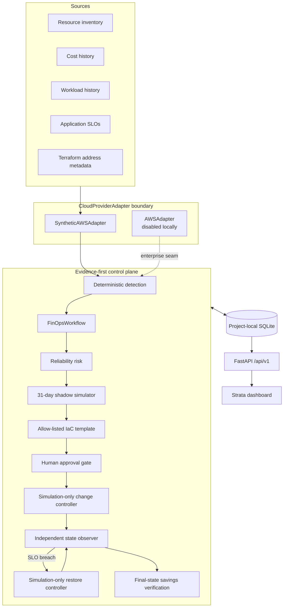
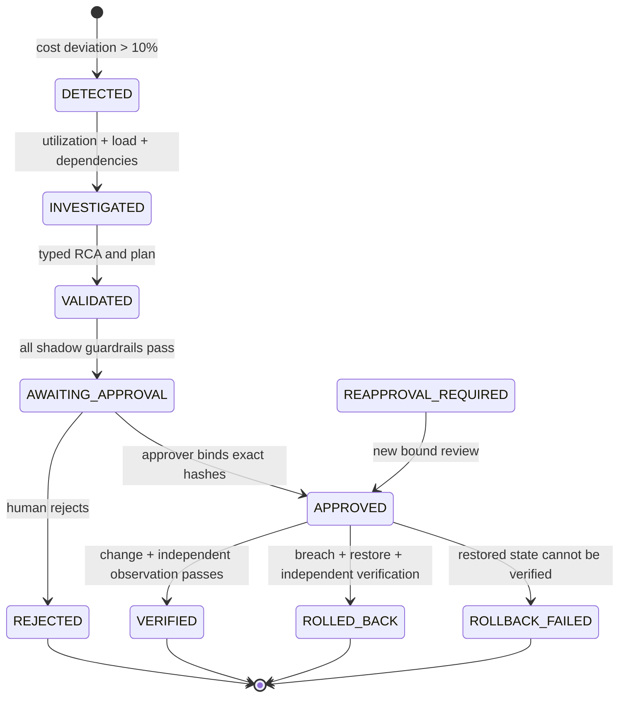
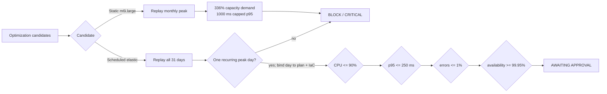

# Architecture

## System architecture

The `CloudProviderAdapter` separates synthetic change, restore, and independent observation operations. `SyntheticAWSAdapter` changes only process-local state; the real `AWSAdapter` implementation fails closed on every operation. The executor only emits an `ExecutionResult(mode="SIMULATION")`; it never parses or runs the Terraform artifact.

## Agent workflow

Agent contracts list responsibility, inputs, outputs, tools, permissions, and failure behavior in `backend/app/agents.py` and at `GET /api/v1/agents`. `FinOpsWorkflow` is the orchestration abstraction; a future LangGraph adapter can call the same deterministic tools and must preserve these state preconditions.

## Validation workflow

Validation is fail-closed: every required guardrail and exact alignment check must exist and pass. The resulting `ValidationResult` persists the typed peak day, plan and Terraform SHA-256 values, projected values, thresholds, comparisons, units, and decision. Approval recomputes the current hashes, compares them to that validation, and appends an immutable reviewer/action/recommendation/validation attestation. Execution recomputes the same bindings before the simulation controller is called. Every run collects current histories and evaluates thresholds first; only an identical detected content fingerprint within the current demo generation is de-duplicated afterward.

## Persistence

SQLite tables cover resources, incidents, evidence, recommendations, validations, approvals, executions, evaluations, runtime state, and audit history. Foreign keys are enabled, WAL supports local concurrent reads, and the schema migration ledger records the initial schema plus bound approvals. Triggers make audit, validation, and approval records append-only and freeze recommendation action/Terraform bytes after validation. Version-1 approvals are not backfilled: active ones become `REAPPROVAL_REQUIRED`. Demo reset increments a generation and preserves governed history.

## Error handling

- Missing or partial evidence stops recommendation generation.
- The real AWS adapter fails with an explicit local-mode error.
- Readiness returns 503 if SQLite is unavailable.
- Invalid state transitions return HTTP 409.
- Missing records return 404; malformed inputs return 422.
- Authorization failure returns 403; rate limits return 429.
- No LLM availability can affect the deterministic workflow in mock mode.
