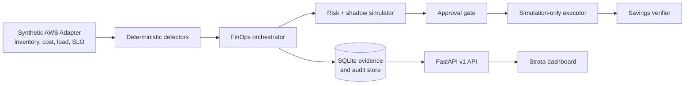

# Strata — Cloud FinOps & Change-Risk Optimization Agent

Strata is a self-contained local POC that answers a harder question than “which cloud resource is cheapest?”: **can we save money without breaching a production SLO?** It combines deterministic detection, an evidence-backed typed investigation, shadow validation, human approval, an inert Terraform proposal, simulated execution, and outcome measurement.

The service runs on port **8102**, requires no cloud account or paid LLM, and never executes Terraform, a shell command, or a real cloud mutation.

## Problem

Average-based rightsizing tools can recommend unsafe changes. The included checkout workload averages 18% CPU across five historical profiles, but a recurring day-28 settlement event reaches 84% for eight hours. Capacity-normalized replay of a static move to the cheapest instance calculates 336% peak demand and a capped 1,000 ms p95 latency projection against a 250 ms SLO.

Existing cost-only approaches are insufficient because they often omit workload seasonality, dependency blast radius, approval state, rollback readiness, and post-change evidence.

## Solution

The demo calculates a 13.02% cost anomaly and 18% historical utilization, consumes five months of adapter workload history, and produces a typed `RCAResult`. It blocks the cheapest option as `CRITICAL`, selects the least-cost proposal that passes a calculated 31-day replay, binds the workload-derived recurring peak day into the typed plan, replay, and review-only Terraform text, waits for an authorized human, then derives $119.01/month realized savings from an independently observed $160.99 post-change cost.

## Architecture



See [ARCHITECTURE.md](ARCHITECTURE.md) for agent and validation diagrams.

## Agent architecture

Eight narrowly scoped agents are declared at `GET /api/v1/agents`: Cost Anomaly, Resource Analysis, Workload Pattern, Optimization, Reliability Risk, IaC, Validation, and Savings Verification. Arithmetic, thresholds, state transitions, and guardrails are deterministic. `LLM_MODE=mock` is disclosed in readiness and the dashboard; no LLM call is needed for this scenario. Agent outputs used for decisions are Pydantic models, not unrestricted prose.

## Workflow

1. Detect a 13% cost increase and persistent 18% average CPU.
2. Investigate five recurring monthly peaks plus the checkout dependency path.
3. Compare a cheapest static option with a safer scheduled elastic plan.
4. Classify risk, blast radius, reversibility, benefit, confidence, approval, and rollback.
5. Replay 31 days and enforce recurrence, CPU, latency, error-rate, and availability guardrails.
6. Produce inert Terraform whose schedule must exactly match the selected plan's evidence-derived peak day; persist plan and artifact SHA-256 evidence.
7. Recompute those hashes at review, then append an immutable approval attestation containing the action/recommendation, validation, exact plan and Terraform hashes, and reviewer identity.
8. Recompute and compare all bindings again immediately before simulated execution; any mismatch fails closed.
9. Persist execution evidence and estimated-vs-realized savings accuracy.

## Technology stack

- Python 3.11+, FastAPI, Pydantic v2
- Standard-library SQLite with WAL, foreign keys, a schema version ledger, immutable audit/validation/approval triggers, and validated-artifact write guards
- Framework-free HTML/CSS/JavaScript dashboard
- Pytest and FastAPI TestClient
- Docker and Docker Compose

## Installation and local setup

### Docker Compose

```bash
docker compose up --build
```

Open <http://localhost:8102>. OpenAPI is at <http://localhost:8102/docs>.

### Python

```bash
python -m venv .venv
# Windows: .venv\Scripts\activate
# macOS/Linux: source .venv/bin/activate
python -m pip install -r requirements.txt
python -m uvicorn backend.app.main:app --host 0.0.0.0 --port 8102
```

Configuration is documented in `.env.example`. The default database is `data/finops.db`.

## Demo

Use the dashboard buttons, or start the service and run:

```bash
python scripts/run_demo.py
```

The script starts a fresh local demo generation without deleting governed history, runs the investigation, records a hash-bound approval, simulates apply, and prints realized savings and SLO outcome. See [DEMO.md](DEMO.md) for raw API calls and expected evidence.

## Failure simulation

The built-in failure is the unsafe cheapest optimization. Inspect `validation.blocked_alternative` at `GET /api/v1/demo`: the calculated 336% capacity demand and 1,000 ms capped latency projection fail all four SLO guardrails. Regression tests also prove that every run re-collects evidence before content de-duplication, day-15 history produces a day-15 plan and Terraform schedule, drifting peaks block scheduled elasticity, and a breaching observed post-state triggers a real simulated restore plus independent post-rollback observation. A verified restore recomputes final savings from the restored state (zero in the default baseline), so evaluation reflects the final outcome.

## Evaluation and metrics

`GET /api/v1/evaluations` exposes calculated scores for:

- cost anomaly detection;
- unsafe optimization prevention;
- risk classification accuracy;
- recommendation acceptance;
- estimated-vs-realized savings accuracy (derived from the selected plan estimate and observed post-change cost).

`GET /api/v1/metrics` returns JSON application metrics; `/metrics` exposes a small Prometheus-compatible text surface. See [EVALUATION.md](EVALUATION.md).

## Security and human approval

Mutation endpoints use an authentication/authorization abstraction through `X-Actor` and `X-Role`. This is deliberately a local POC seam, not production authentication. Only `approver` and `admin` roles can approve, reject, reset, or simulate. A passing validation is mandatory before approval. Approval stores immutable SHA-256 bindings to the exact validated plan, action bytes, and Terraform bytes plus the recommendation/action/validation IDs and reviewer identity; execution recomputes them all. Migration never backfills old approvals: active legacy approvals become `REAPPROVAL_REQUIRED` and permit a fresh bound review. The only controller is hard-coded `SIMULATION`; its apply/restore/observe operations mutate local in-memory synthetic state only, while `AWSAdapter` fails closed and IaC remains text. Inputs are typed and bounded, CORS is allow-listed, requests are rate-limited, and secrets are never persisted. See [SECURITY.md](SECURITY.md).

## Screenshots

Run the app, open the dashboard at 1440×900, and capture:

1. the hero, savings KPIs, and “cheapest blocked” frontier;
2. the 31-day SLO guardrail panel and inert Terraform proposal;
3. the post-apply realized savings state.

Place captures in `docs/screenshots/` if maintaining the portfolio in source control.

## Tests

```bash
python -m pytest
```

The suite includes unit, adapter/tool, API, workflow, failure, authorization, persistence, validation, and evaluation checks.

## Limitations

Cloud pricing, telemetry, shadow behavior, apply, and realized savings are deterministic simulations. Authentication and rate limiting are process-local. SQLite is appropriate for this isolated POC, not a horizontally scaled control plane. See [LIMITATIONS.md](LIMITATIONS.md).

## Future improvements

- Add read-only AWS CUR, CloudWatch, Compute Optimizer, and service-catalog adapters.
- Replace headers with OIDC/JWT and policy-based authorization.
- Add a durable workflow engine and PostgreSQL for multi-instance operation.
- Calibrate shadow models using production load tests and deployment telemetry.
- Add externally signed attestations and a separate, tightly scoped deployment service.

## Interview talking points

- Why average utilization is not a sufficient rightsizing feature.
- Why the safest plan saves less than the cheapest plan, and how that tradeoff is made inspectable.
- Which decisions are deterministic and where an LLM could safely add synthesis without owning enforcement.
- How fail-closed validation, RBAC, inert IaC, rollback, and a separate simulation boundary prevent production damage.
- How outcome verification distinguishes estimated savings from measured realized savings.
